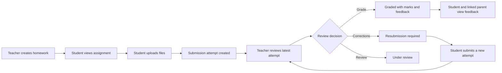
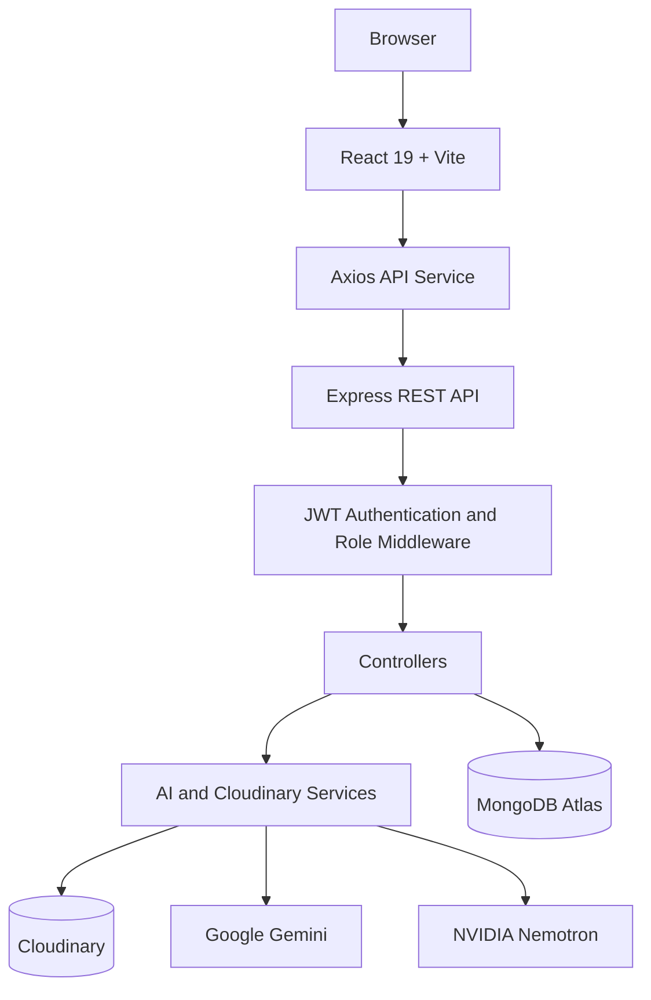

# Smart School Connect

[](https://smart-school-connect-psi.vercel.app)
[](https://smart-school-connect-api.onrender.com)
[](https://react.dev/)
[](https://expressjs.com/)
[](https://www.mongodb.com/)

Smart School Connect is a full-stack school communication and academic management platform for **teachers, students, and parents**. It centralizes class organization, homework, submissions, announcements, parent–teacher conversations, and role-aware AI assistance.

- **Live application:** https://smart-school-connect-psi.vercel.app
- **Production API:** https://smart-school-connect-api.onrender.com

## Table of Contents

- [Overview](#overview)
- [Technology Stack](#technology-stack)
- [Role-Based Features](#role-based-features)
- [Major Application Modules](#major-application-modules)
- [AI Integration](#ai-integration)
- [Security and Authentication](#security-and-authentication)
- [Application Architecture](#application-architecture)
- [Repository Structure](#repository-structure)
- [Local Development Setup](#local-development-setup)
- [Environment Variables](#environment-variables)
- [Running Locally](#running-locally)
- [API Overview](#api-overview)
- [Production Deployment](#production-deployment)
- [Testing and Quality Checks](#testing-and-quality-checks)
- [UI and UX](#ui-and-ux)
- [Future Improvements](#future-improvements)

## Overview

The platform connects school activity across three protected roles:

- **Teachers** create and manage classes and homework, publish announcements, review submissions, and communicate directly with parents.
- **Students** view assigned work, submit files, track due dates and grades, read announcements, and use the Stella/Ask School AI assistant.
- **Parents** monitor only their linked children's homework and submissions, view feedback and grades, read announcements, and communicate with assigned teachers.

## Technology Stack

### Frontend

| Technology | Purpose |
|---|---|
| React 19 | Role-based user interface |
| Vite 8 | Development server and production build |
| React Router 7 | Client-side routing and protected routes |
| Material UI 9 | Components, responsive layouts, and themes |
| Axios | API requests and JWT attachment |
| React Markdown | Rendering AI responses |
| React Three Fiber / Drei / Three.js | Animated 3D Stella AI avatar |

### Backend

| Technology | Purpose |
|---|---|
| Node.js | Backend runtime |
| Express 5 | REST API framework |
| MongoDB with Mongoose 9 | Data persistence and ODM |
| JWT | Stateless authentication |
| bcryptjs | Password hashing |
| Multer | In-memory homework file uploads |
| Cloudinary | Authenticated homework file storage |
| CORS | Configured browser-origin control |
| dotenv | Environment configuration |

### AI

| Integration | Use |
|---|---|
| Google Gemini API via `@google/genai` | Optional Gemini provider |
| NVIDIA API / Nemotron | Default provider for chat and AI features |

## Role-Based Features

### Teacher

- Role-specific dashboard with class, student, homework, announcement, and direct-message counts.
- Create classes and add existing registered students.
- Optionally link a registered parent account while adding a student.
- Create homework for owned classes with title, description, and due date.
- View homework submission counts and statuses.
- Review the latest attempt for each student submission.
- Set a submission to `under_review`, `graded`, or `resubmission_required`.
- Add marks and teacher feedback.
- Send class announcements to students and linked parents.
- Improve announcement drafts with role-protected AI assistance.
- Create, view, reply to, and update parent–teacher conversations.
- Ask Stella about owned classes and created homework.

### Student

- Dashboard with overdue, due-today, upcoming, and completed homework counts.
- Homework search and status filters.
- Submission support for **JPG, JPEG, PNG, and PDF** files.
- Maximum of five files per attempt; maximum 10 MB per file.
- Submission history with attempt numbers and timestamps.
- Marks and feedback visibility.
- Ability to resubmit only after the teacher requests resubmission.
- Signed five-minute access to owned submission files.
- Class announcements and Ask School AI access.

### Parent

- Dashboard with linked-child homework summaries.
- Filter the dashboard and homework view by linked child.
- View only homework belonging to each linked child's class.
- Track overdue, due-today, upcoming, submitted, graded, and pending work.
- View linked-child submission history and teacher feedback.
- Read announcements addressed to the parent account.
- Parent–teacher conversations linked to the parent's child and the assigned teacher.
- Access Ask School AI and role-aware homework summaries for linked children only.

## Major Application Modules

### Authentication and Authorization

Accounts support `student`, `teacher`, and `parent` roles. Registration validates required fields and email format, requires passwords of at least eight characters, and stores bcrypt-hashed passwords. Login returns a JWT containing the user ID and role.

Both backend middleware and frontend route guards are used. A missing or invalid JWT returns `401`; an authenticated user with the wrong role receives `403` on protected backend routes.

### Dashboard System

Each role has a dedicated dashboard:

- Teachers see classes, unique students, homework, announcements, and conversations.
- Students see due-date and completion information.
- Parents see data aggregated for their linked children.

### Class and Student Management

A teacher may create a class and add a registered student account by email. The teacher can also link an existing parent account to that student. A student can belong to only one class in the current implementation.

### Homework Management

Teachers create assignments for classes they own. Homework includes a title, description, due date, target class, and creator.

### Homework Submissions

A submission record is unique per student and homework and contains an ordered attempt list. The workflow is:



Only the latest attempt can be reviewed, and a student can create another attempt only after a teacher selects `resubmission_required`.

### File Uploads and Access

Files are read into memory with Multer, validated by both MIME type and file-header signatures, then uploaded to `smart-school-connect/homework` in Cloudinary with authenticated delivery. PDFs are stored as raw resources and images as image resources.

Authorized file access generates a signed Cloudinary URL valid for five minutes. Access is restricted to:

- the submitting student;
- the teacher who created the homework; or
- a parent linked to the student.

### Announcements

Teachers send categorized class announcements. The recipients include class students and parents linked to those students. Students can view announcements for their assigned class, while parents receive only announcements that name them as recipients.

### Messaging and Conversations

The application has two messaging models:

- **Class announcements** for one-way teacher updates.
- **Parent–teacher conversations** for threaded direct communication.

Conversations have categories, priorities, status values, participant authorization, and read tracking.

### AI Assistance

The backend provides three role-aware AI capabilities:

- improved teacher announcement text;
- homework summaries using only authorized role-specific data; and
- a conversational **Ask School AI** assistant with a limited chat history.

## AI Integration

### Provider Architecture

`aiService.js` selects a provider adapter:

- `gemini` — Google `gemini-3.8-flash` through `@google/genai`;
- `nemotron` — NVIDIA Nemotron 3.5 via the NVIDIA chat-completions API.

Nemotron is the frontend default and also the server-level default for most AI requests.

### Gemini

The Gemini adapter sends prompts with `thinking_level: low`, `max_output_tokens: 1024`, and `store: false`, then returns `interaction.output_text`.

### NVIDIA Nemotron

The Nemotron adapter sends prompts to `nvidia/nemotron-3.5-super-vl-120b-a12b` with non-streaming JSON chat completion, low reasoning effort, a 4096-token limit, and temperature `0.6`.

### Role-Aware Data Boundaries

The AI controllers retrieve fresh data after authentication:

- **Student:** own class, homework, submission attempts, and announcements.
- **Parent:** only linked children's data and announcements addressed to the parent.
- **Teacher:** only owned classes, created homework, submissions, and announcements.

Prompts explicitly instruct the AI not to invent records and not to expose database IDs or unrelated users.

## Security and Authentication

- Passwords are hashed with bcrypt using 10 rounds.
- Login issues JWT bearer tokens configured through `JWT_SECRET` and `JWT_EXPIRES_IN`.
- Axios attaches `Authorization: Bearer <token>` to API requests.
- `authMiddleware` validates bearer tokens and returns `401` for missing, invalid, or expired credentials.
- `authorizeRoles` returns `403` when an authenticated role is not permitted.
- Frontend `ProtectedRoute` provides route-level UI protection for the three roles.
- Backend resource checks additionally verify class ownership, parent–child relationships, submission ownership, and homework ownership.
- Submission files are uploaded with authenticated Cloudinary delivery; access URLs expire after five minutes.
- CORS allows only `http://localhost:5173` and `https://smart-school-connect-psi.vercel.app` in the verified backend configuration.
- Root and nested `.env` patterns are excluded by Git ignore rules.

Frontend route protection is a usability guard and must not be considered an authorization boundary. Backend middleware and resource checks are the authoritative security controls.

## Application Architecture



## Repository Structure

```text
Smart-School-Connect/
├── backend/
│   ├── config/             # MongoDB and Cloudinary configuration
│   ├── controllers/        # Authentication, classes, homework, submissions,
│   │                       # announcements, conversations, and AI logic
│   ├── middleware/         # JWT auth, role authorization, upload validation
│   ├── models/             # Mongoose models
│   ├── routes/             # Express route definitions
│   ├── services/
│   │   ├── ai/             # Gemini and Nemotron adapters
│   │   └── aiService.js    # Provider selection
│   │   └── cloudinaryService.js
│   ├── test*.js            # Manual provider/API test scripts
│   ├── package.json
│   └── server.js
├── frontend/
│   ├── public/             # Icons and the Stella 3D model
│   ├── src/
│   │   ├── components/
│   │   │   ├── ai/         # Floating Stella chat and 3D/avatar components
│   │   │   ├── common/     # Shared controls
│   │   │   └── layout/     # Dashboard layout, sidebar, topbar, route guard
│   │   ├── context/        # Light/dark theme context
│   │   ├── features/
│   │   │   └── conversations/
│   │   ├── pages/          # Role dashboards and functional pages
│   │   └── services/api.js # Axios client and 401 handling
│   ├── package.json
│   └── vite.config.js
└── .gitignore
```

## Local Development Setup

### Prerequisites

- Git
- Node.js 18 or newer (Node.js 20+ is recommended)
- npm
- MongoDB Atlas account or another accessible MongoDB instance
- Cloudinary account
- Google Gemini API key and/or NVIDIA API key for AI features

### Clone

```bash
git clone https://github.com/SherwinjClitus/Smart-School-Connect.git
cd Smart-School-Connect
```

### Install Frontend

```bash
cd frontend
npm install
```

### Install Backend

```bash
cd ../backend
npm install
```

## Environment Variables

No `.env.example` files are currently present. Create local `.env` files only as needed and never commit them.

### Backend

Create `backend/.env`:

```env
PORT=5000
MONGO_URI=
JWT_SECRET=
JWT_EXPIRES_IN=1d
CLOUDINARY_CLOUD_NAME=
CLOUDINARY_API_KEY=
CLOUDINARY_API_SECRET=
GEMINI_API_KEY=
NVIDIA_API_KEY=
```

| Variable | Purpose |
|---|---|
| `PORT` | Express listening port; defaults to `5000` |
| `MONGO_URI` | MongoDB connection string |
| `JWT_SECRET` | Secret used to sign and verify JWTs |
| `JWT_EXPIRES_IN` | JWT lifetime passed to `jsonwebtoken` |
| `CLOUDINARY_CLOUD_NAME` | Cloudinary cloud name |
| `CLOUDINARY_API_KEY` | Cloudinary API key |
| `CLOUDINARY_API_SECRET` | Cloudinary API secret |
| `GEMINI_API_KEY` | Google Gemini API key |
| `NVIDIA_API_KEY` | NVIDIA API bearer key |

### Frontend

Create `frontend/.env` for a non-default API host:

```env
VITE_API_URL=http://localhost:5000/api
```

The deployed frontend can use:

```env
VITE_API_URL=https://smart-school-connect-api.onrender.com/api
```

The Axios client falls back to `http://localhost:5000/api` when `VITE_API_URL` is absent. Every `VITE_` variable is exposed to browser code and must not contain secrets.

## Running Locally

### Terminal 1 — Backend

```bash
cd backend
npm run dev
```

The backend listens on `http://localhost:5000` when `PORT` is not set.

### Terminal 2 — Frontend

```bash
cd frontend
npm run dev
```

Vite normally starts the frontend at `http://localhost:5173`. This origin is explicitly allowed by the backend CORS configuration.

## API Overview

All routes require authentication unless stated otherwise.

### Authentication

| Method | Route | Purpose | Authentication |
|---|---|---|---|
| `POST` | `/api/auth/register` | Register a teacher, student, or parent | Public |
| `POST` | `/api/auth/login` | Authenticate and receive a JWT | Public |

### Protected and Role-Check Routes

| Method | Route | Purpose | Role |
|---|---|---|---|
| `GET` | `/api/protected` | Verify authenticated access | Any authenticated user |
| `GET` | `/api/teacher-only` | Verify teacher role access | Teacher |

### Classes

| Method | Route | Purpose | Role |
|---|---|---|---|
| `POST` | `/api/classes` | Create a class | Teacher |
| `GET` | `/api/classes/my-classes` | Fetch owned classes | Teacher |
| `POST` | `/api/classes/:classId/students` | Add a student and optional parent link | Teacher |

### Homework

| Method | Route | Purpose | Role |
|---|---|---|---|
| `POST` | `/api/homework` | Create homework | Teacher |
| `GET` | `/api/homework/teacher` | Fetch teacher-created homework and stats | Teacher |
| `GET` | `/api/homework/student` | Fetch assigned homework | Student |
| `PATCH` | `/api/homework/:homeworkId/complete` | Mark homework completed | Student |
| `GET` | `/api/homework/parent` | Fetch homework for all linked children | Parent |
| `GET` | `/api/homework/child/:childId` | Fetch homework for one linked child | Parent |

### Submissions

| Method | Route | Purpose | Role |
|---|---|---|---|
| `GET` | `/api/submissions/student` | Fetch student submission history | Student |
| `POST` | `/api/submissions/:homeworkId` | Submit or resubmit homework files | Student |
| `GET` | `/api/submissions/homework/:homeworkId` | Fetch submissions for an assignment | Teacher |
| `PATCH` | `/api/submissions/:submissionId/attempt/:attemptNumber/review` | Review the latest attempt | Teacher |
| `GET` | `/api/submissions/parent/:childId` | Fetch a linked child's submissions | Parent |
| `GET` | `/api/submissions/:submissionId/attempt/:attemptNumber/file/:fileId` | Generate five-minute signed file access | Student, Teacher, or Parent |

### Announcements and Class Messages

| Method | Route | Purpose | Role |
|---|---|---|---|
| `POST` | `/api/messages` | Send a class announcement | Teacher |
| `GET` | `/api/messages/teacher` | Fetch sent announcements | Teacher |
| `GET` | `/api/messages/parent` | Fetch announcements for the parent | Parent |
| `GET` | `/api/messages/student` | Fetch announcements for the student's class | Student |

### Conversations

| Method | Route | Purpose | Role |
|---|---|---|---|
| `POST` | `/api/conversations` | Create a parent–teacher conversation | Parent or Teacher |
| `GET` | `/api/conversations` | Fetch the user's conversations | Parent or Teacher |
| `GET` | `/api/conversations/:conversationId/messages` | Fetch and mark conversation messages | Participant |
| `POST` | `/api/conversations/:conversationId/messages` | Send a reply | Participant |
| `PATCH` | `/api/conversations/:conversationId/status` | Update conversation status | Teacher |

### AI

| Method | Route | Purpose | Role |
|---|---|---|---|
| `POST` | `/api/ai/improve-message` | Improve an announcement draft | Teacher |
| `POST` | `/api/ai/homework-summary` | Summarize role-authorized homework data | Student, Parent, or Teacher |
| `POST` | `/api/ai/chat` | Ask School AI about authorized school data | Student, Parent, or Teacher |

Route files in `backend/routes/` and controllers in `backend/controllers/` provide the implementation source for payload details and response behavior.

## Production Deployment

### Frontend — Vercel

- **Live:** https://smart-school-connect-psi.vercel.app
- **Framework:** Vite
- **Root directory:** `frontend`
- **Build command:** `npm run build`
- **Output directory:** `dist`
- **Environment:** `VITE_API_URL=https://smart-school-connect-api.onrender.com/api`

### Backend — Render

- **Live:** https://smart-school-connect-api.onrender.com
- **Runtime:** Node.js
- **Root directory:** `backend`
- **Build command:** `npm install`
- **Start command:** `npm start`
- Render supplies `PORT`; the server falls back to `5000` locally.

### Database

MongoDB Atlas is accessed through `MONGO_URI`.

### File Storage

Cloudinary stores submission files and creates authenticated delivery URLs. Cloud credentials must remain in backend environment variables.

### CORS

The backend allows the production Vercel origin and `http://localhost:5173`. A frontend domain change requires updating the `origin` array in `backend/server.js`.

Free Render instances may spin down after inactivity, so the first production API request after inactivity can be slower.

## Testing and Quality Checks

### Available Commands

Frontend:

```bash
cd frontend
npm run lint
npm run build
```

Backend:

```bash
cd backend
npm start
npm run dev
```

The backend package also includes manual provider scripts (`testAIService.js`, `testGemini.js`, `testNemotron.js`, and `testAIComparison.js`). They are ad hoc scripts, not an established automated test suite.

No backend `test` script or conventional frontend/backend unit-test suite is currently configured. Verified project checks mentioned for this application include linting, Vite builds, role-based workflows, JWT access checks, and homework submission and review flows; automated test coverage should not be inferred from these manual checks.

## UI and UX

- Role-specific dashboards and navigation sidebars.
- Responsive Material UI cards, dialogs, tabs, tables, and forms.
- Light/dark theme persisted in `localStorage`.
- Consistent blue, orange, green, purple, and red status palettes.
- Student homework filtering and due-date-aware status labels.
- Parent child-selection controls.
- A floating animated 3D Stella avatar with a reduced-motion-aware chat interface.
- AI responses rendered using React Markdown.

## Future Improvements

The following items are recommendations rather than existing functionality:

- Add automated unit, integration, and end-to-end test suites.
- Add OpenAPI/Swagger documentation.
- Add CI/CD checks for lint, build, tests, and dependency scanning.
- Improve structured logging and production monitoring.
- Add code splitting and route-level performance optimization.
- Strengthen account provisioning and administrator workflows.
- Add automated accessibility checks and a formal accessibility audit.
- Standardize API error schemas and review Cloudinary migration for legacy files.
